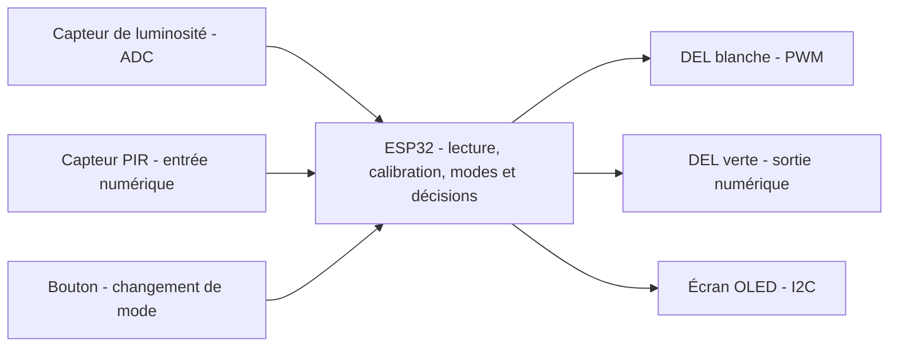

# Livrable 1 – Choix de projet et plan de projet

**Cours :** 420-314 – Programmation de plateformes embarquées  
**Projet :** Lampadaire intelligent à économie d’énergie  
**Équipe :** Karlens Joakym Jadotte et Mathieu Joseph  
**Date :** 24 novembre 2026

## 1. Description du problème et fonction du prototype

Les lampadaires peuvent rester allumés à pleine intensité même lorsqu’il fait jour ou lorsque personne ne circule. Cela entraîne une consommation d’énergie inutile. Notre projet consiste à créer un lampadaire miniature qui adapte son éclairage à la luminosité ambiante et aux mouvements détectés.

En mode automatique, le lampadaire s’éteint lorsqu’il fait clair. Dans l’obscurité, il fonctionne à 20 % de sa puissance lorsqu’aucun mouvement n’est détecté et à 100 % lorsqu’un mouvement est détecté. Il revient à 20 % après 5 secondes sans mouvement. Un bouton permet de passer au mode manuel, dans lequel le lampadaire reste à 100 %. Une DEL verte indique la détection de mouvement et un écran OLED affiche le mode, la luminosité et l’intensité de la lampe.

| Mode | Condition | Intensité PWM |
|---|---|---:|
| Automatique | Luminosité ≥ 50 % | 0 % |
| Automatique | Luminosité < 50 %, aucun mouvement récent | 20 % |
| Automatique | Luminosité < 50 %, mouvement récent | 100 % |
| Manuel | Toutes les conditions | 100 % |

Les seuils de 50 %, 20 % et la durée de 5 secondes sont des choix préliminaires à ajuster lors des essais. La luminosité sera exprimée en pourcentage relatif après calibration, et non en lux.

## 2. Diagramme fonctionnel du système

Le programme MicroPython lira les entrées, interprétera les mesures et commandera les sorties. Des fonctions séparées seront utilisées pour les capteurs, le bouton, les sorties et l’affichage. Les temporisations seront gérées avec `ticks_ms()` et `ticks_diff()` sans longue attente bloquante. Si l’écran ne répond pas, le programme poursuivra la gestion de la lampe, signalera l’erreur par le témoin et tentera de rétablir la communication.

## 3. Liste préliminaire des composants

| Matériel (nom dans l’inventaire) | Qté | Fonction | Stock indiqué |
|---|---:|---|---:|
| Arduino Nano ESP32 | 1 | Microcontrôleur | 2 |
| Photocell Sensor | 1 | Capteur analogique de luminosité | 26 |
| PIR Motion Sensor | 1 | Capteur numérique de mouvement | 59 |
| White LED Module | 1 | Éclairage à intensité variable (PWM) | 23 |
| RGB LED Module | 1 | Témoin vert numérique | 17 |
| 128x32 OLED Display with I2C | 1 | Affichage, nouveau composant proposé | 25 |
| Push Button | 1 | Changement de mode | 22 |

Matériel complémentaire : breadboard, fils, câble USB, résistances si nécessaires selon les modules, carton et matériel de fixation. La breadboard est indiquée à 0 dans l’inventaire; nous utiliserons celle de notre matériel de cours si disponible. Les quantités indiquées ne constituent pas une réservation.

L’écran OLED est le nouveau composant proposé : il nécessite une communication I2C et une bibliothèque adaptée à son contrôleur. Nous vérifierons sa référence et sa documentation avant l’intégration.

## 4. Attribution préliminaire des broches

| Composant / signal | Broche Nano | GPIO ESP32 | Type |
|---|---|---:|---|
| Photocell – sortie analogique | A3 | 4 | ADC |
| PIR – sortie signal | D7 | 10 | Entrée numérique |
| DEL blanche – commande | D2 | 5 | PWM |
| DEL RVB – canal vert | D3 | 6 | Sortie numérique |
| Bouton – signal | D10 | 21 | Entrée numérique |
| OLED – SDA | A4 | 11 | I2C données |
| OLED – SCL | A5 | 12 | I2C horloge |
| Masse commune | GND | — | Masse |

Les broches sont préliminaires. Les tensions d’alimentation, la polarité des DEL, les résistances et les niveaux logiques seront confirmés selon les modules reçus. Aucun signal supérieur à 3,3 V ne sera appliqué directement aux GPIO. Toutes les masses seront communes. Le capteur de luminosité sera placé à l’écart de la DEL pour éviter que celle-ci fausse sa mesure.

## 5. Répartition initiale du travail

| Responsable | Tâches prévues |
|---|---|
| Karlens | Lecture et calibration du capteur de luminosité, commande PWM, logique des modes. |
| Mathieu | Lecture du PIR, bouton, témoin numérique et intégration de l’écran OLED. |
| Ensemble | Intégration, tests, gestion des erreurs, maquette, documentation et présentation. |

Chaque membre effectuera des commits et push selon sa contribution. Les deux membres comprendront l’ensemble du projet.

**Plan de réalisation :** semaine du 30 novembre : tests séparés des entrées et sorties et documentation OLED; semaine du 7 décembre : intégration et test complet; au plus tard le 10 décembre : calibration, robustesse, maquette, README et vidéo de secours. La maquette représentera une petite rue avec un lampadaire fixé, des fils organisés et un écran et un bouton accessibles.

## 6. Dépôt GitHub

**Nom proposé :** 420-314-Eclairage-Intelligent  
**Lien :** https://github.com/KJ-1st/420-314-Eclairage-Intelligent.git

Le livrable sera déposé dans le dépôt de l’équipe et le lien sera transmis à la personne enseignante.

## Sources et utilisation de l’IA

- Énoncé de l’épreuve finale 420-314, automne 2026, pages 1 à 4 et 6.
- Inventaire du matériel fourni : Gallery.csv.
- Documentation Arduino Nano ESP32 : https://docs.arduino.cc/tutorials/nano-esp32/cheat-sheet/
- ChatGPT : aide à la conception, à la structuration du plan et à la rédaction. Les choix seront validés par l’équipe et les composants testés avant la réalisation finale.
